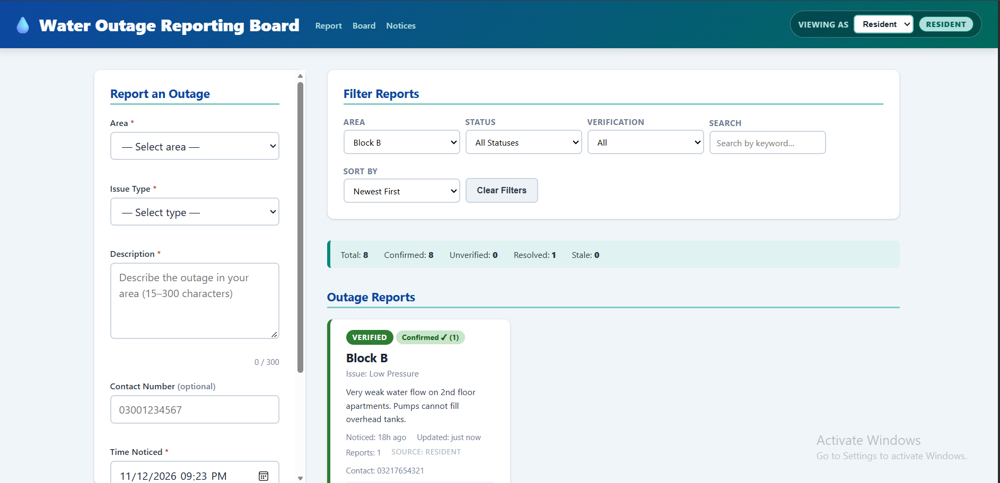

# Water Outage Reporting Board

> **Web Engineering — Assignment 1: Client-Side Web Application**  
> **Assigned Project Idea:** #23 — Water Outage Reporting Board

A lightweight, fully client-side neighborhood water outage reporting and verification dashboard. Built strictly with semantic HTML5, modern vanilla CSS, and vanilla JavaScript (ES6+). Operates entirely offline using browser `localStorage` with zero frameworks, external libraries, or backend dependencies.

---

## 1. Setup & Running the Application

This web application requires no installation, package manager, or build step. You can launch it using either method:

### Option A: Direct File Launch (Completely Offline)
1. Clone or download this repository:
   ```bash
   git clone <repository-url>
   cd webdevASS1
   ```
2. Double-click `index.html` or open it directly in any modern web browser (Google Chrome, Mozilla Firefox, Microsoft Edge, or Apple Safari).

### Option B: Local Development Server
If you prefer running through a local HTTP server:
```bash
# Start a simple Python HTTP server from the project root
python -m http.server 8000
```
Then open your browser and visit:
```
http://localhost:8000
```

---

## 2. Features

- **Area-Based Outage Reporting:** Submit incident reports across 8 designated municipal areas (`Block A`, `Block B`, `Block C`, `Market Road`, `Green Park`, `Old Town`, `Station Colony`, `University Road`) with specific issue types (`No Water`, `Low Pressure`, `Dirty Water`, `Pipe Burst`).
- **Duplicate Detection & Interactive Merging:** Detects active, non-resolved reports in the same area with the same issue type submitted within a 2-hour window. Prompts the user to either merge into the existing report (incrementing confirmations) or file a separate incident.
- **Verification Workflow:** Visual distinction between unverified and confirmed outages. Reports reaching 3 confirmations automatically transition to **Verified** status.
- **Moderation Controls:** Role-free simulation to moderate reports directly from the cards: verify reports, advance status along defined state transitions, and delete spam or obsolete entries with confirmation.
- **Stale-Data Handling:** Automatic detection of reports unupdated for over 24 hours. Flags them with a prominent **Stale** badge and provides a *"Re-confirm Outage"* button to refresh the incident timestamp.
- **Live Search & Multi-Criteria Filtering:** Instant live filtering across Area, Status, Verification state, and full-text keyword search, paired with sorting options (Newest, Oldest, Most Reports) and a one-click filter reset.
- **Board Notices Feed:** Timestamped administrative notices bulletin rendered newest-first, with an integrated submission form.
- **Live Summary Counters:** Dynamic statistics bar tracking Total, Confirmed, Unverified, Resolved, and Stale incident counts.
- **Data Provenance:** Tracks report origins (`resident`, `neighbor`, `utility staff`) and records merge audit trails.
- **Accessibility & Safety:** Strict heading hierarchy, full keyboard operability (<kbd>Tab</kbd>, <kbd>Enter</kbd>, <kbd>Space</kbd>), visible `:focus-visible` contrast indicators, and complete XSS protection (using `textContent` DOM node creation).
- **Graceful Persistence:** Safely reads/writes to `localStorage` with error handling that falls back to seed data if storage is corrupted or disabled.

---

## 3. Screenshots

| Mobile View (375px) | Tablet View (768px) | Desktop View (1280px) |
| :---: | :---: | :---: |
|  |  |  |
| *Single-column fluid flow* | *Two-column responsive card grid* | *Sticky sidebar form + 3-column grid* |

*(Place PNG or JPEG captures into the `screenshots/` directory named `mobile.png`, `tablet.png`, and `desktop.png`.)*

---

## 4. Project Structure

```
webdevASS1/
├── index.html              # Semantic HTML5 document, accessible form & filter structure
├── DESIGN.md               # WDLC stages, user workflow, wireframes, and data/status models
├── README.md               # Setup instructions, architecture, rubric mapping, and guide
├── css/
│   └── style.css           # Design tokens, mobile-first CSS Grid & Flexbox layouts
├── js/
│   ├── data.js             # Global constants, 8 seed reports with provenance, 3 notices
│   └── app.js              # Vanilla JS controller: validation, duplicate merge, filtering
└── screenshots/
    ├── mobile.png          # Placeholder for mobile viewport capture
    ├── tablet.png          # Placeholder for tablet viewport capture
    └── desktop.png         # Placeholder for desktop viewport capture
```

---

## 5. Attributions & Disclosures

### Attribution & Clean Code Policy
- **Zero Third-Party Assets:** No external JavaScript libraries, UI frameworks (Bootstrap, Tailwind), CSS preprocessors, icon fonts, templates, or runtime dependencies were used.
- **Pure Web Standards:** All styling and logic were developed strictly using vanilla HTML5, CSS3, and modern vanilla JavaScript.
- **Privacy & Security:** No real personal credentials, API keys, passwords, or private individual data are included in this codebase. All phone numbers, names, and incident descriptions in the seed data are completely fictional.

### AI Assistance Disclosure
An AI coding assistant was used during the development of this project for initial architectural brainstorming, syntax suggestions, and code review. In accordance with university academic integrity policies, I personally reviewed, tested, debugged, and modified all code, styles, and documentation to ensure strict adherence to assignment requirements.
