# 💧 Water Outage Reporting Board

**Web Engineering — Assignment 2: PHP, PDO/SQLite & Fetch Application**  
**Assigned Project Idea:** #23, Water Outage Reporting Board

🔗 **Deployed URL:** https://water-outage-reporting-board-f2f26.containers.snapdeploy.app

A responsive, full-stack web application where neighbourhood residents report water outages, see which areas are affected, and distinguish confirmed reports from unverified ones. Real authenticated users (`resident` and `admin`) interact through a vanilla JavaScript `fetch` (`async/await`) frontend backed by a PHP JSON API, PDO prepared statements, and an SQLite database.

---

## 1. The Problem & Solution

In many neighbourhoods, water supply is unreliable. When water stops flowing, residents do not know whether the outage affects only their house or the whole street, complaints are scattered across phone calls and group chats, duplicate reports clutter the picture, and old reports stay visible after water returns.

The **Water Outage Reporting Board** provides one shared board where:
- Residents report an outage in seconds with area, issue type, description, optional contact, and time noticed.
- Everyone sees live board statistics and whether reports are **Confirmed** or **Unverified**.
- Near-duplicate reports in the same area within 2 hours can be merged instead of cluttering the board.
- Unresolved reports not updated for 24 hours are automatically flagged **Stale**.
- Utility moderators (`admin`) can verify reports, advance statuses (`reported → verified → in-progress → resolved`), re-confirm stale reports, and publish or delete official notices.

---

## 2. Architecture

```
Browser (HTML5 + CSS3 + public/js/app.js)
   │  fetch(..., { credentials: 'same-origin', headers: { 'X-CSRF-Token': ... } })
   ▼
PHP JSON API (public/api/auth.php, reports.php, notices.php)
   │  Session Auth + CSRF + Server Validation (src/)
   ▼
PDO (Prepared Statements, ATTR_EMULATE_PREPARES = false, PRAGMA foreign_keys = ON)
   ▼
SQLite Database (database/app.sqlite)
```

Browser storage (`localStorage`) is used **only** for a single non-sensitive UI preference (`wob_pref_sort`) inside `try/catch`. All reports, notices, confirmations, users, and sessions live on the server.

---

## 3. Features

- **Full CRUD without page reloads:** Create, read, update, and delete outage reports via `fetch` with loading (`aria-busy`), success, empty, and error/retry states.
- **Role-based access & session ownership:**
  - `resident` can submit reports, confirm others' reports (`"I'm affected too"`), and edit or delete **only their own** reports while status is `reported`.
  - `admin` sees the Moderator Dashboard, verifies reports, transitions statuses using `ALLOWED_TRANSITIONS`, re-confirms stale reports, deletes any report, and posts or deletes notices.
- **Duplicate detection & merging:** Server detects unresolved reports with the same `area` and `issue_type` within 2 hours and returns `409` with the existing report so the user can merge or submit as new.
- **Auto-verification:** Reaching 3 confirmations automatically marks a report as verified.
- **Live filtering, search & sort:** Filter by area, status (including computed `stale`), and verification; 300 ms debounced keyword search with `AbortController` to prevent stale responses overwriting newer ones; sort by newest, oldest, or most reports.
- **Accessibility & responsive design:** Mobile-first CSS Grid/Flexbox (mobile `< 600px`, tablet `600px+`, desktop `1024px+`), semantic landmarks, `aria-live` status regions, `:focus-visible` rings, and text-labelled badges.

---

## 4. Local Setup

### Prerequisites & Required PHP Extensions
- **PHP 8.2+** (tested on PHP 8.2.35 locally and PHP 8.5 in Docker)
- **Required extensions:**
  - `pdo_sqlite` and `sqlite3` (required for SQLite database access via PDO)
  - `curl` (required only to run the automated CLI test suite `tests/run_tests.php`)
- **Optional extension:**
  - `mbstring` (used by `utf8_length()` in `src/validate.php` when enabled; falls back automatically to `iconv_strlen` / `preg_match_all('/./us', ...)` when disabled)

### Windows (PowerShell)
```powershell
cd webdevASS1
php database/seed.php
php -S localhost:8000 -t public
```
Open [http://localhost:8000](http://localhost:8000) in your browser.

### Linux / macOS
```bash
cd webdevASS1
php database/seed.php
php -S localhost:8000 -t public
```
Open [http://localhost:8000](http://localhost:8000) in your browser.

### Troubleshooting
- **`Call to undefined function mb_strlen()`**: Fixed in `src/validate.php` via `utf8_length()`, which no longer requires `mbstring`. If you want `mbstring` enabled anyway, open `php.ini` (find its path with `php --ini`), uncomment `extension=mbstring`, and restart the PHP server.
- **`could not find driver` (PDOException)**: Enable SQLite in `php.ini` by uncommenting `extension=pdo_sqlite` and `extension=sqlite3` (and ensure `extension_dir = "ext"` on Windows), then restart `php -S localhost:8000 -t public`.

---

## 5. Demo Accounts (Local Testing)

| Username | Password | Role | Display Name |
|---|---|---|---|
| `admin` | `Admin#2026` | `admin` | Municipal Admin |
| `resident1` | `Resident#2026` | `resident` | Ayesha Khan |
| `resident2` | `Resident#2027` | `resident` | Bilal Ahmed |

---

## 6. API Endpoints

| Method | URL | Auth / Role | Success | Error Codes |
|---|---|---|---|---|
| `GET` | `/api/auth.php` | Anyone (returns current user + CSRF token) | `200` | `405` |
| `POST` | `/api/auth.php` | Anyone (`action: "login"`); Authenticated (`action: "logout"`) + CSRF | `200` | `400`, `401`, `403`, `422`, `429` |
| `GET` | `/api/reports.php` | Anyone (filters: `area`, `status`, `verified`, `q`, `sort`) | `200` | `422` |
| `POST` | `/api/reports.php` | Authenticated + CSRF | `201`, `200` (merge) | `400`, `401`, `403`, `409`, `422` |
| `POST` | `/api/reports.php?id={id}&action=confirm` | Authenticated + CSRF | `200` | `400`, `401`, `403`, `404`, `409` |
| `PUT` | `/api/reports.php?id={id}` | Owner (`resident` while `reported`) or `admin` + CSRF | `200` | `400`, `401`, `403`, `404`, `409`, `422` |
| `DELETE` | `/api/reports.php?id={id}` | Owner (`resident` while `reported`) or `admin` + CSRF | `200` | `400`, `401`, `403`, `404` |
| `GET` | `/api/notices.php` | Anyone | `200` | — |
| `POST` | `/api/notices.php` | `admin` + CSRF | `201` | `400`, `401`, `403`, `422` |
| `DELETE` | `/api/notices.php?id={id}` | `admin` + CSRF | `200` | `400`, `401`, `403`, `404` |

---

## 7. Database Schema (SQLite)

Defined in [database/schema.sql](database/schema.sql):

- **`users`**: `id` (PK), `username` (UNIQUE), `password_hash`, `role` (`CHECK (role IN ('resident', 'admin'))`), `display_name`.
- **`reports`**: `id` (PK), `area`, `issue_type` (`CHECK` on 4 types), `description`, `contact`, `time_noticed`, `status` (`CHECK` on 5 statuses), `verified` (`0`/`1`), `owner_id` (FK → `users.id`), `source`, `report_count`, `created_at`, `updated_at`. Indexed on `area` (`idx_reports_area`) and `status` (`idx_reports_status`).
- **`report_confirmations`**: `id` (PK), `report_id` (FK → `reports.id`), `user_id` (FK → `users.id`), `created_at`, with `UNIQUE (report_id, user_id)`.
- **`notices`**: `id` (PK), `title`, `message`, `author_id` (FK → `users.id`), `created_at`.

---

## 8. Security Measures

| Threat | Protection Implemented |
|---|---|
| **SQL Injection** | PDO prepared statements with bound parameters and `ATTR_EMULATE_PREPARES => false`; `LIKE` wildcards escaped. |
| **XSS** | `htmlspecialchars(..., ENT_QUOTES \| ENT_SUBSTITUTE, 'UTF-8')` in PHP; `textContent` and `createElement` in JS (never `innerHTML`). |
| **CSRF** | Per-session `random_bytes(32)` token verified via `hash_equals()` on `X-CSRF-Token` for all state-changing requests. |
| **Session Fixation** | `session_regenerate_id(true)` on login; `HttpOnly`, `SameSite=Lax`, `use_strict_mode=1`, `use_only_cookies=1`. |
| **Password Storage** | `password_hash(..., PASSWORD_DEFAULT)` and `password_verify()`, plus a 5-attempt / 30-second login rate limit. |
| **Authorization** | Server-side `require_login()`, `require_admin()`, and `owner_id` checks; `contact` hidden from non-owners/non-admins. |

---

## 9. Running Automated Tests

All numbers and results in this README come from the actual test run executed on **2026-11-27** (**12 / 12 passed, 0 failed**). See [tests/last_run.txt](tests/last_run.txt) for the full output and [TESTING.md](TESTING.md) for the complete test matrix.

With the server running (`php -S localhost:8000 -t public`), run:
```bash
php tests/run_tests.php
```
This resets the database via `database/seed.php` and runs all 12 cURL integration tests (**T1–T12**).

---

## 10. Deployment (Docker & SnapDeploy)

Deployed live at: https://water-outage-reporting-board-f2f26.containers.snapdeploy.app

- Built directly from [Dockerfile](Dockerfile) (`php:8.5-cli` with `pdo_sqlite` and `mbstring` enabled) and [.dockerignore](.dockerignore).
- Binds to SnapDeploy's dynamic `$PORT` (`php -S 0.0.0.0:${PORT:-8000} -t public`) and runs `php database/seed.php` on every container startup so the ephemeral SQLite database always initializes with fresh demo data.
- On the free tier, the container sleeps after 15 minutes of inactivity and wakes automatically on the next request.

---

## 11. Screenshots

### Assignment 2 (Full-Stack PHP + SQLite + Fetch)

| View / State | Screenshot | Caption |
|---|---|---|
| Login bar & logged-out view | 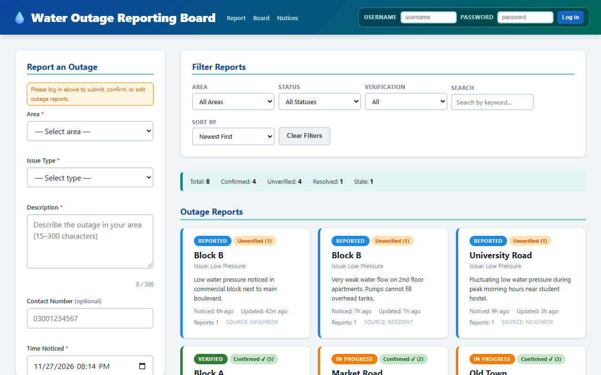 | Header login form with real labels and logged-out "Please log in" notice. |
| Reports list (logged in) | 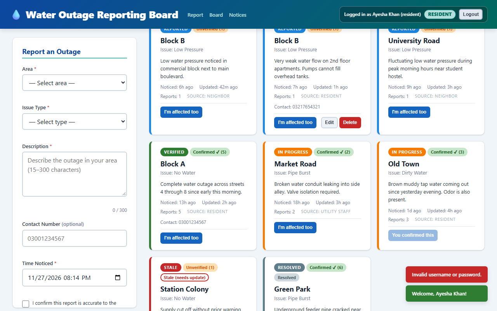 | Authenticated `resident1` view showing report cards, badges, and summary stats. |
| Resident ownership controls | 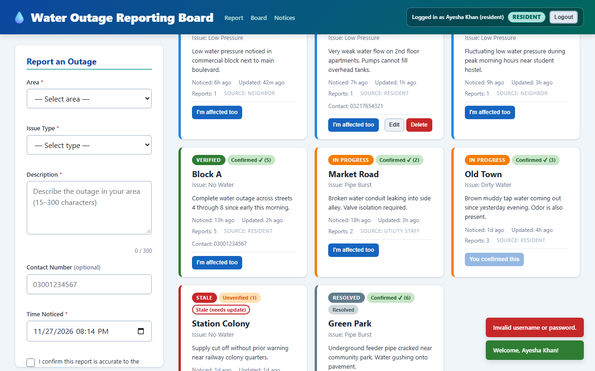 | Edit & Delete buttons appear only on reports owned by `resident1` while `reported`. |
| Reports loading state | 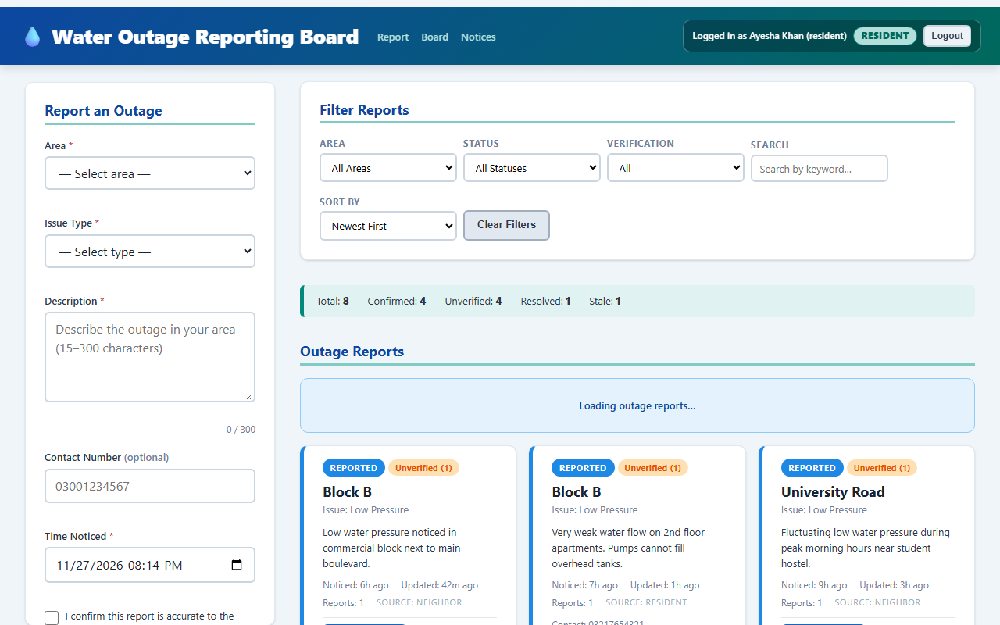 | `aria-busy` loading banner shown while `/api/reports.php` is in flight. |
| Empty state (no matches) | 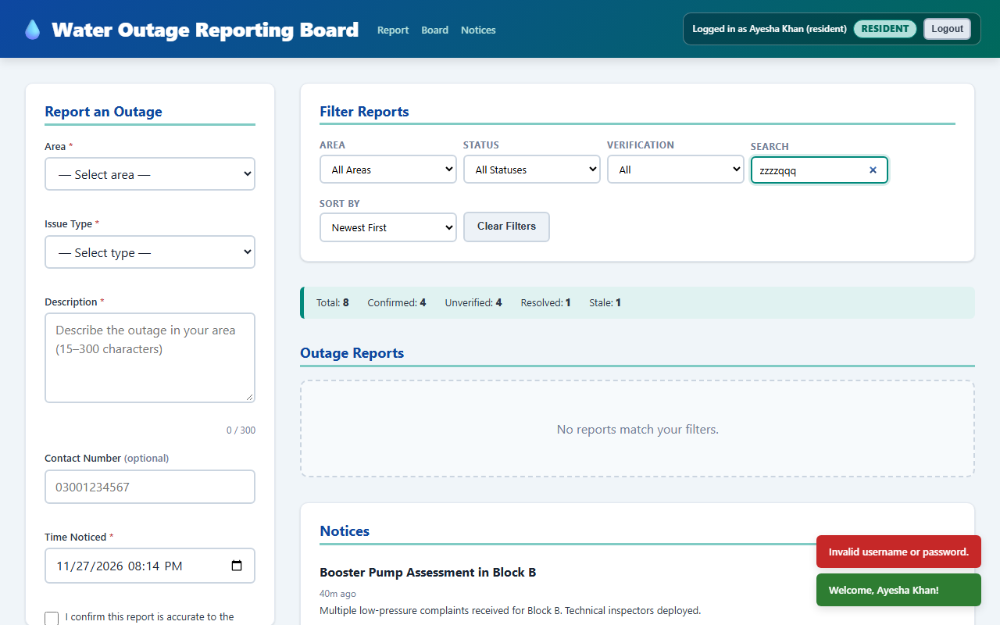 | Empty state message displayed when keyword search (`zzzzqqq`) matches no reports. |
| Error state with Retry | 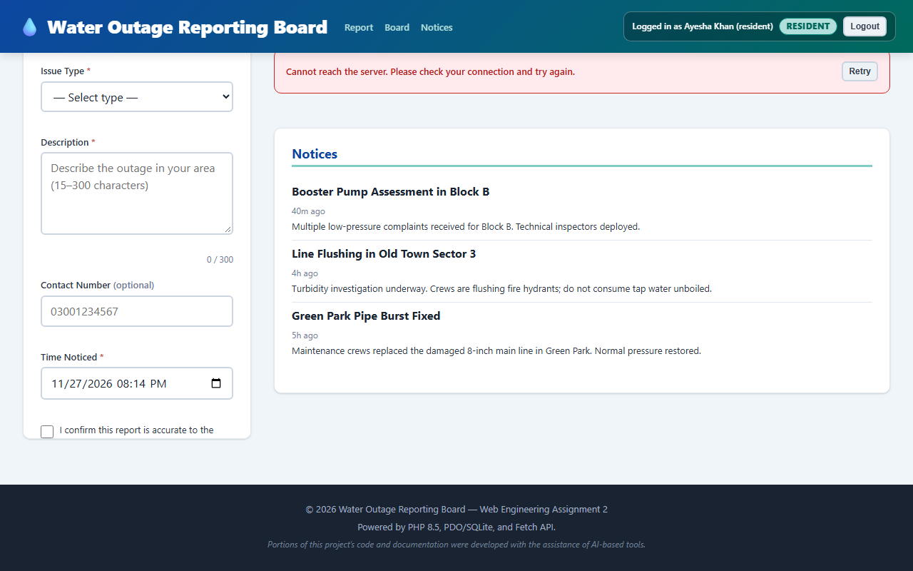 | Network/API failure banner with working Retry button for `/api/reports.php`. |
| Server 422 validation errors | 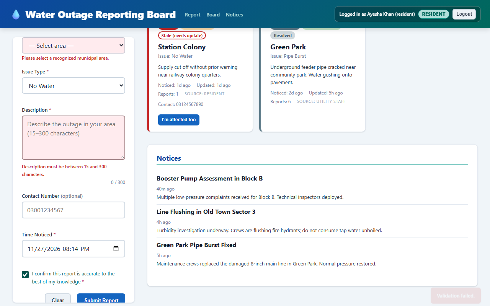 | Field-level 422 validation errors rendered directly below invalid inputs. |
| Duplicate detection prompt (409) | 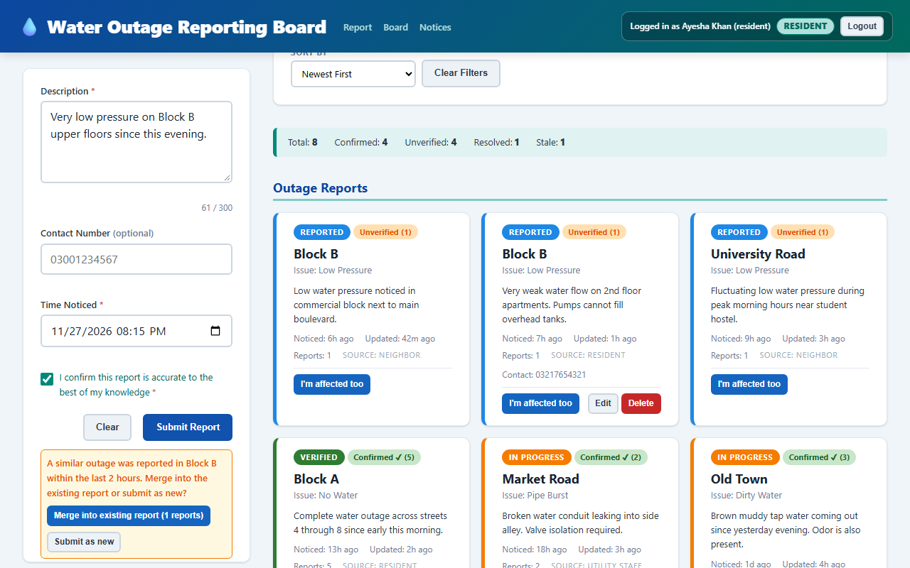 | 409 conflict prompt offering "Merge into existing report" or "Submit as new". |
| Report submission success | 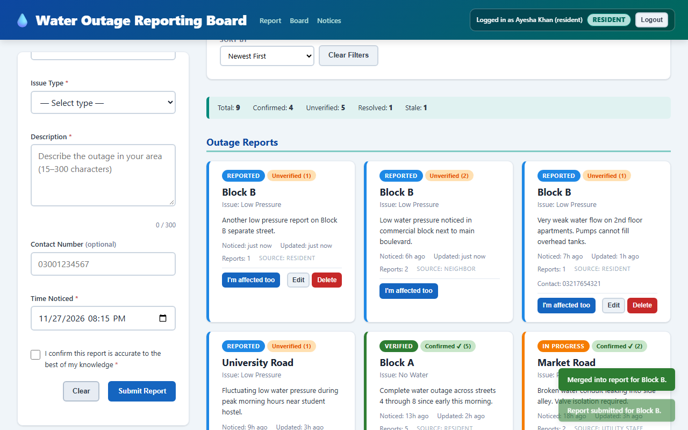 | Success toast notification after submitting a valid outage report. |
| Admin Moderator Dashboard | 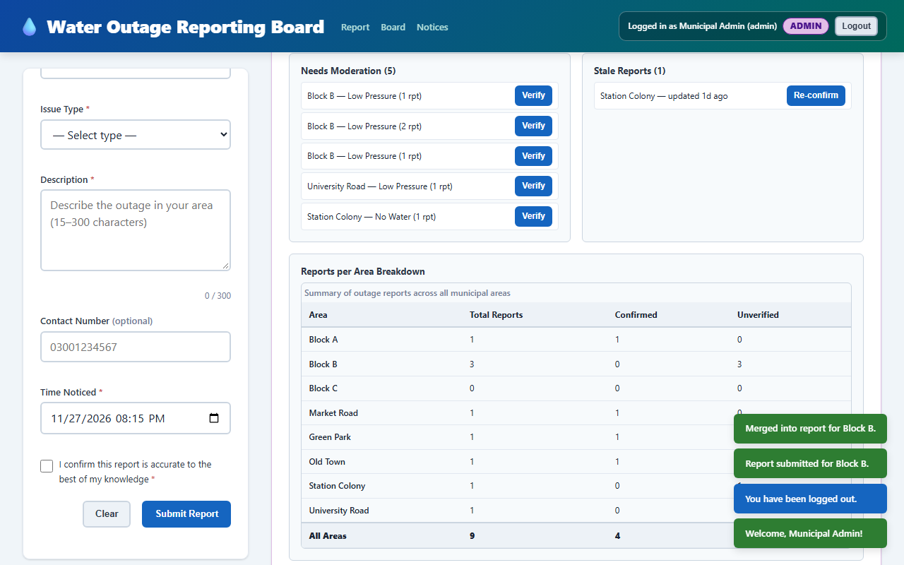 | Admin-only dashboard with Needs Moderation, Stale Reports, and Area Breakdown table. |
| Admin Notices & Add Notice form | 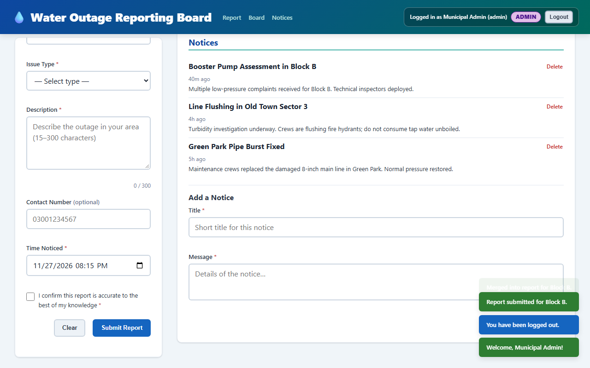 | Admin view of timestamped notices with Delete buttons and the Add a Notice form. |
| Mobile layout (375px) | 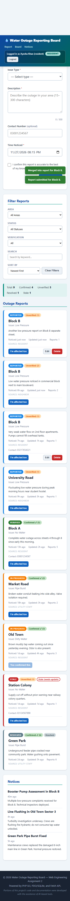 | Full-page responsive layout at 375px width with zero horizontal overflow. |
| Tablet layout (768px) | 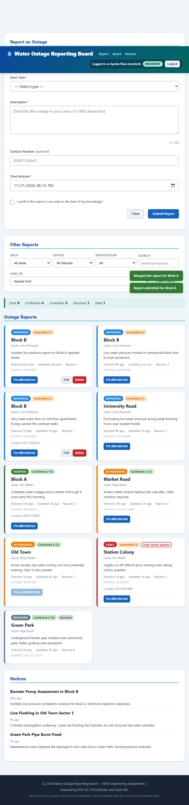 | Full-page responsive layout at 768px width with zero horizontal overflow. |
| CLI test run output (`T1–T12`) | 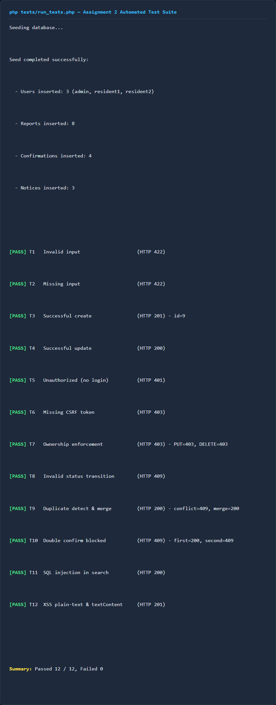 | Terminal output of `php tests/run_tests.php` showing all 12 tests passing. |

### Assignment 1 screenshots (client-only version)

- [Desktop Overview](screenshots/desktop.png)
- [Desktop Resident View](screenshots/desktop-resident-view.png)
- [Desktop Admin View](screenshots/desktop-admin-view.png)
- [Filter Bar](screenshots/filter-bar.png)
- [Filters & Summary Stats](screenshots/filters-and-summary-stats.png)
- [Report Form](screenshots/report-form.png)
- [Report Form Submission Success](screenshots/report-form-submission-success.png)
- [Report Card (Resident View)](screenshots/report-card-resident-view.png)
- [Notices Board (Resident View)](screenshots/notices-board-resident-view.png)
- [Notices Admin Add Notice Form](screenshots/notices-admin-add-notice-form.png)
- [Unhydrated Initial State](screenshots/error-unhydrated-initial-state.png)

---

## 12. Attribution & AI Disclosure

- **Attribution:** Built with PHP, PDO, SQLite, semantic HTML5, CSS3, and vanilla JavaScript. No external PHP composer packages, JS libraries, or CSS frameworks are used. All demo accounts, phone numbers, and outage records are fictional.
- **AI Assistance Disclosure:** Portions of this project's code, tests, and documentation were developed with the assistance of AI-based tools. All code was reviewed, tested, and verified by the author.
